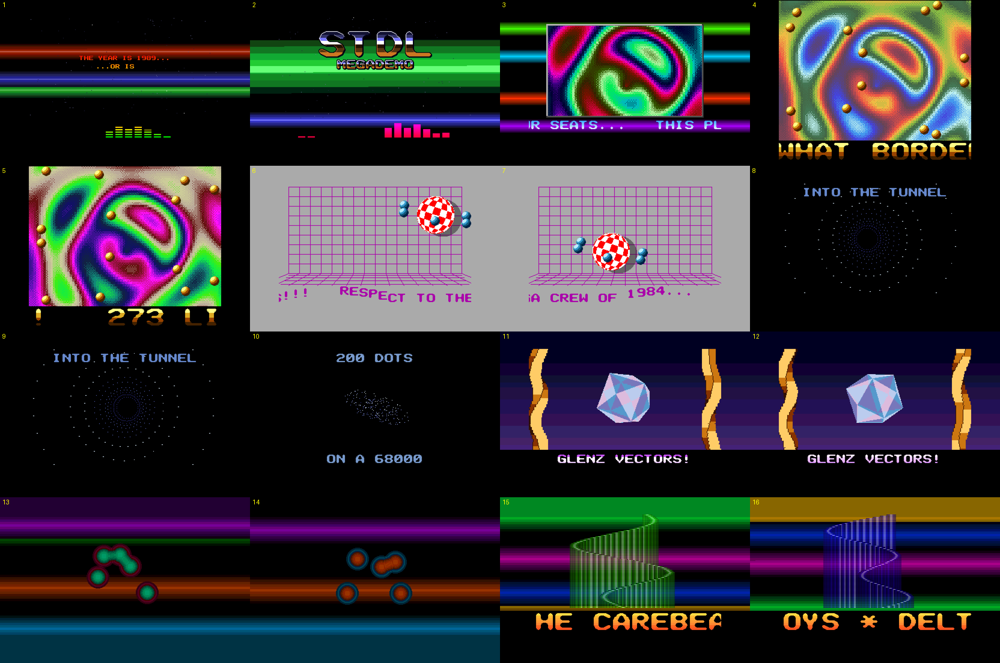

# STDL Megademo



A tribute the 80s/90s Atari ST demoscene, by [Neil Rackett](https://neilrackett.com/atarist)

## Introduction

A real Atari ST megademo built on [STDL](https://github.com/neilrackett/atarist-stdl),
the planar-native SDL subset for the ST. It runs on a plain 8MHz 520/1040 ST with
1MB, and on an STE or Mega STE. It plays a 107-second YM2149 soundtrack, and seven
parts are cut to the beat:

| Bars  | Part      | What's on screen                                                                                                                                                                                                                  |
| ----- | --------- | --------------------------------------------------------------------------------------------------------------------------------------------------------------------------------------------------------------------------------- |
| 0-7   | Intro     | Timer B copper bars behind a 3D starfield, typewriter text in a raster rainbow, the chrome logo dropping on the boom, and an LED spectrum analyser driven by the YM registers the music sets                                      |
| 8-15  | Plasma    | A palette-cycled plasma boxed inside the ST's border, with coppers running through the side borders. On bar 12 the borders go: 273 lines of overscan, bobs flying through the old top border and a scroller in the old bottom one |
| 16-23 | Boing     | The Amiga ball, spun by palette rotation, bouncing on every kick, with a one-bitplane shadow, orbiting vector bobs and hopping letters                                                                                            |
| 24-31 | Tunnel    | A dot tunnel flying down a curving tube, then a 3D dot morph (sphere, torus, cube, STDL, helix) that explodes on the snare roll                                                                                                   |
| 32-39 | Glenz     | Glenz vectors: a checkered tetrakis hexahedron of see-through glass, with twisters on either side and a Timer B sky                                                                                                               |
| 40-47 | Metaballs | Blobs summed by a bitplane adder into chrome over coppers, with a word shouted on every clap. The acid line is on                                                                                                                 |
| 48-55 | Outro     | Kefrens bars over coppers, greetings, thanks, and a fade back to the top                                                                                                                                                          |

## Running it

Copy `dist/MEGADEMO.TOS` to a floppy, a hard disk or a GEMDOS drive, and run it.
The music is linked in, so it's the only file. It needs a colour monitor or TV at
50Hz and 1MB of memory.

| Key         | Action                                    |
| ----------- | ----------------------------------------- |
| Space       | Start (on the title), then pause / resume |
| 1-7         | Jump to a part                            |
| Left, Right | Previous / next part                      |
| Esc         | Quit                                      |

In Hatari: `hatari --machine st --tos <a TOS or EmuTOS image> dist/MEGADEMO.TOS`.

## Building

```sh
git submodule update --init --recursive
STCMD_NO_TTY=1 stcmd make
```

This cross-compiles with m68k-atari-mint-gcc 4.6 inside
[atarist-toolkit-docker](https://github.com/sidecartridge/atarist-toolkit-docker).
STDL is the `stdl/` submodule, and its `libstdl.a` is built on the way. The build
is warning-free under `-Wall -Wextra`.

The font, the logo, the Boing ball, the bob, the sine table and the whole
soundtrack are generated by the two Python tools. They're pure Python with no
packages, so they run in the container too:

- `tools/mkassets.py` writes `src/gen/assets.*`. The 8x8 font is designed in
  that file. The 16- and 32-pixel fonts and the chrome logo come from it via
  Scale2x/Scale3x, and the Boing ball is drawn there.
- `tools/mksong.py` writes the YM soundtrack and its sync table. The song is the
  arrangement of the three.js cracktro that inspired this, cut down to three
  square waves:
  - **Voice A:** the hardware envelope as a buzzer bass, the acid line and pads.
  - **Voice B:** the lead and 50Hz chip-chord arpeggios.
  - **Voice C:** drums made of tone sweeps and noise.

  The tool renders one register frame per VBL into `src/gen/stm.*`, a
  `STDL_Music` stream linked into the program, plus `src/gen/song.*`, the
  per-row table every effect syncs to.
  `WAV=out.wav python3 tools/mksong.py` also writes a rough host-side render.

`make` regenerates either output when its tool changes.

## How it's built

**STDL does the platform.** That covers init and exit, double-buffered video and
flipping, the overscan (`STDL_OpenTopBorder` + `STDL_OpenBottomBorder` give the
273-line screen in the plasma part, with the bottom border calibrated behind a
black screen while the loader runs), the Timer B rasters (`STDL_OpenRasters`,
colour 0 plus colour 15 or 8 every 2 or 4 lines, with a prefix on TOS's Timer C
so its 200Hz tick can't shake the bars), the YM music replay (`STDL_Music`: the
song is played from memory, a part jump is `STDL_SeekMusic`, and the analyser
reads `STDL_GetMusicRegisters`), the VBL callback, events and keys, the palette
word format, and the multiply and divide helpers that keep gcc away from
libgcc's (`STDL_MulS16`, `STDL_FixDiv`). It also does the drawing
work where its general routines fit: fills, the logo and Boing-ball blits
(`STDL_BlitSurface`, `STDL_BlitSprite` with pre-shifting on a plain ST),
`STDL_DrawChar`, the dirty-rectangle restore, and loading art from chunky bytes
(`STDL_SurfaceFromIndexed8`, `STDL_SpriteFromSurface`).

**Native code is where a demo needs a special case.** That means STDL's
general-purpose paths (clip, mask upkeep, plane budget, colour dispatch on every
call) cost more in set-up than the pixels do. These loops are 68000 assembly,
inline in the C files:

- **Starfield, tunnel rings and dot morph** (`intro.c`, `tunnel.c`): project,
  clip and plot in one loop, about a third of the cost of `STDL_PointsC` for
  dots on a screen the demo owns.
- **Glenz filler** (`fast.c`): trapezoids XORed straight into one bitplane, with
  the edges stepped in registers. Front faces go in planes 2-3 and back faces
  in 0-1, so the palette does the translucency. The back faces are drawn at half
  vertical resolution, because only the glass shows them.
- **Metaball adder** (`meta.c`): a saturating ripple-carry add of 3-bit blobs
  into the four screen planes, 16 pixels at a time.
- **Kefrens, twisters, bobs and scroller bands** (`outro.c`, `glenz.c`, `bobs.c`,
  `text.c`/`fast.c`): pre-shifted or pre-drawn data copied with `movem` and
  long moves.

Everything runs on the song's clock: the frame the YM is playing, from
`STDL_MusicFrame`. A part that renders at 25fps still lands every flash on its
drum.
The frame rate is adaptive: each frame measures its own cost, and the flip
holds the steadiest rate the machine sustains.

### Frame rates

Measured in Hatari (cycle-exact) with EmuTOS, and the same under TOS 1.04 on the
plain ST:

| Part             | Plain ST / STE, 8MHz | Mega STE, 16MHz |
| ---------------- | -------------------- | --------------- |
| Intro            | 50                   | 50              |
| Plasma, boxed    | 50                   | 50              |
| Plasma, overscan | 25                   | 25              |
| Boing            | 25                   | 50              |
| Tunnel / morph   | 50 / 25              | 50 / 50         |
| Glenz            | 16.7                 | 25              |
| Metaballs        | 25                   | 25-50           |
| Outro            | 25                   | 50              |

The loader takes about 7.9 seconds on a plain ST and 4 on a Mega STE.

These figures are emulator-only so far. Nothing has run on real hardware yet.

## Testing

`tools/hatari/` drives STDL's own Hatari harness (`stdl/tests/hatari/run.sh`).
It needs an EmuTOS image in `tmp/tos/etos256uk.img`, or any image passed as `TOS=`:

- `tools/hatari/tour.sh NAME st|ste|megaste` jumps through every part and takes
  screenshots, writing a contact sheet to `tmp/out/`. It also prints the frame
  statistics the demo writes to the console when it exits: frames, VBLs, fps,
  and how many frames took 1, 2, 3 or 4+ VBLs.
- `tools/hatari/prof.sh NAME PART SECONDS` profiles one part with Hatari's CPU
  profiler and ranks the functions by cycles per frame. The script header
  explains the two steps of the recipe that aren't obvious.

## Code map

```
src/
  main.c       boot, loader, title, the part sequencer, adaptive frame pacing
  core.c       VBL service, song clock and seek, staged palette; colour tables
  raster.c     the demo's names for STDL's rasters; the table shown with the flip
  text.c       fonts, 1bpp scroller bands
  fast.c       the shared 68000 loops: span fills, clears, band output, glyphs
  bobs.c       pre-shifted 16x16 bobs with restore
  dots.c       dot erase
  intro.c plasma.c boing.c tunnel.c glenz.c meta.c outro.c   the parts
  gen/         generated by tools/ (assets, the song and its sync table)
tools/
  mkassets.py  font, logo, ball, bob, sine
  mksong.py    the YM soundtrack and its sync table
  hatari/      test and profiling scripts
```

## Licence

Copyright (C) 2026 Neil Rackett. GPL-3.0-or-later: see [LICENSE](LICENSE). Each
file carries an SPDX header, and the generators put one on the sources they
write. STDL, linked in from the `stdl/` submodule, is LGPL-2.1-or-later.
